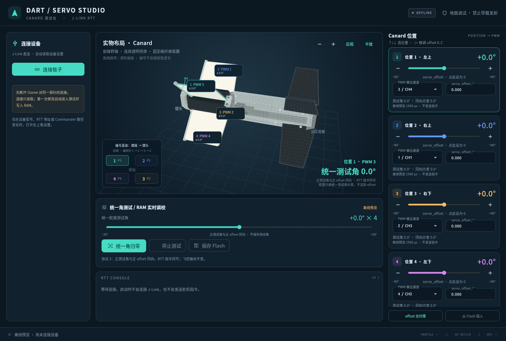

# Dart Servo Studio

Flutter / Dart 桌面调试台，通过 **J-Link RTT channel 1** 直接控制 GuideDart 的四路舵机。已提供 Linux Release 应用；Windows runner 已准备，但没有在本机编译验证。无需 Python 桥接、无需串口。



## 启动

```bash
cd /home/litwei/projects/dart_servo_studio
./run.sh
```

默认只显示**离线预览**，不自动连接、不自动驱动舵机。左侧点“连接板子”即可启动 J-Link 并自动读取设备配置；Host、端口、MCU 型号、SWD 速率等只在齿轮“连接设置”里。四个独立滑条及两侧 −/+ 修改 `servo_offset`；中间统一滑条向四路发送相同测试角。

`./run.sh --build` 重建并启动；`./run.sh --dev` 以 Flutter 调试模式启动。SDK 位于本项目 `.tools/flutter`（已忽略），没有修改系统 PATH；也可以设置 `FLUTTER=/path/to/flutter/bin/flutter` 使用自己的 SDK。当前版本 Flutter 3.47.6 / Dart 3.13.5。首次从纯源码构建需要 Flutter SDK 和 Linux 的 clang、CMake、Ninja、GTK 3 开发环境，见 [Flutter 官方桌面文档](https://docs.flutter.dev/platform-integration/desktop)。

直接运行已构建应用不需要 SDK：

```bash
./build/linux/x64/release/bundle/dart_servo_studio
```

分发时需要复制**整个 `bundle/`**，不只是单个可执行文件。

## 首次连接：先更新固件

当前统一角语义为 `PWM位置 = 90° + servo_angle − servo_offset`：零指令保持中位，正测试角与正 offset 的作用方向相反。请自行用 Ozone / J-Link 下载此次编译的协议 6 固件：

- `/home/litwei/projects/2027_GuideDart/build/gcc/F411Frame.elf`
- 当前 GUI 连接时会执行 `servo control acquire`，仅在收到 `active=1` 后才显示连接成功；旧固件没有控制租约，因此会拒绝连接。`ping` 应返回 `protocol=v6`。
- 此次 RTT 手动测试角撤销协议 3 的取负转换，**需要重新下载协议 4 固件**。GUI 不会自行烧录；只更新 GUI 而不更新板上固件，不会改变 RTT 实际方向。
- ELF 路径只用于 `nm` 提取 `_SEGGER_RTT` 地址，**GUI 不下载、不暂停、不复位 MCU**。必须和板上固件一致；不要沿用旧地址或旧 `build/F411Frame.elf`。
- 没有 `nm` 时可手填 RTT 地址；该字段覆盖 ELF 路径。两者都空则尝试 SEGGER 自动发现，但此探针的自动发现此前不可靠。

连接方式：

1. 先让板上固件运行到初始化完成，断开 Ozone / 其他 RTT channel 1 客户端。
2. **齿轮设置内的“由软件启动 J-Link Commander”默认开启**：GUI 自行启动 `JLinkExe`，保持其 stdin 打开；断开或关闭窗口时只清理自己创建的进程。不发 `g`、`halt`、`reset` 或下载命令。默认设备 `STM32F411CEUx` / SWD 4000 kHz。
3. **在齿轮设置内关闭该选项**：连接已有 RTT TCP 服务，默认 `127.0.0.1:19021`，此时 GUI 不负责已有服务的生命周期。远程服务也用此模式。
4. 点击“连接板子”，自动读取当前零点、实际映射和 Flash 已保存值，并获取客户端控制租约。获取租约**不改变当前 PWM**，但从此普通飞控停止覆盖舵机输出；RAM 控件立即可用，不必解锁。第一次修改再获取独立的手动测试租约。

如端口已占用，GUI 拒绝再启动 Commander，不会杀掉其他调试器；可在齿轮设置里关闭启动开关，连接现有服务。连接与命令原始信息显示在 RTT Console。TCP 接口无认证，应只在受控调试环境使用，不向公网暴露。

## 操作流程

**务必断开发射动力，在静止、空载、机械无干涉的地面条件下操作。**

1. **连接后直接调 RAM**：没有默认锁定、解锁按钮或“应用设置”步骤，RAM 编辑不弹确认。第一次修改自动进入固件测试模式，初始指令角归零，保留 offset；若第一次操作是统一角滑条，则随即发送所选角度。MCU 继续采样，暂停常规控制、姿态更新和发射积分，避免输出被覆盖。仍须满足地面待机 / Flash 不忙的固件准入条件。
2. **四个独立 offset 滑条**：只修改对应逻辑舵机的 `servo_offset`，范围 −90°..+90°、步进 0.1°；两侧 −/+ 每次精确微调 0.1°，旁边输入框可输入到 0.001°。键盘 `↑` / `↓` 循环选择位置 1..4，`←` / `→` 或 `-` / `=` 对选中位置分别微调 −0.1° / +0.1°；长按微调键会在 350 ms 后每 50 ms 连续调节，继续长按会逐步加速，松开即停。输入框获得焦点时快捷键不抢键。拖动 / 输入有效值立即排队写 RAM（快速拖动每约 80 ms 合并最新值），不修改当前统一指令角、不自动写 Flash。输入无效时不发送；拖动该 offset 滑条可清除无效输入并恢复同步。
3. **统一舵面测试角滑条**：范围 −30°..+30°、步进 0.5°；**GUI +θ° 直接向 RTT 发送 `servo_angle=+θ°`，增大 PWM 位置；正 `servo_offset` 则减小 PWM 位置**。协议 4 手动测试角与正常飞控 `Servo_SetAng()` 同号，协议 2 / 3 旧固件的统一角滑条禁用。无实测位置反馈，GUI 不能直接测量舵机性能。
4. **PWM index**：下拉框选择直接写入 RAM，改动 `Servo_ID` 的真实输出映射，不只是标签。选择已占用通道会自动交换两路，保持一一映射。修改映射 / offset 期间，最新统一角请求也会被保留并依序同步，不需要再次“应用”。
5. **批量 offset 操作**：“offset 全归零”直接把四路零点写入 RAM，不弹确认、不写 Flash；“从 Flash 载入”重新读取已保存的 offset 和 PWM 映射并写入 RAM，不使用旧缓存。Flash 无记录时保持 RAM 不变；旧版记录只有 offset 时保留当前 PWM 映射。
6. **保存 Flash**：仅此按钮写非易失存储，并保留单独确认。会先同步最后一批排队的 RAM 设置、统一角归零并退出测试，然后等待 `DONE FLASH status=OK`，回读 offset / 映射核验。保存保留 ICM / ADXL 校准；`servo_angle` 永不保存。保存后 RAM 控件仍可直接使用，不重新锁定。
7. **统一角归零**保留测试模式和各路 offset；**停止测试**先完成有效 RAM 修改、再回中并退出手动测试，但只要 GUI 仍连接，客户端租约继续阻止普通飞控覆盖 PWM。下一次修改自动进入测试，不必解锁。断开 / 关闭窗口先等待正在进行的请求并发送停止、释放客户端租约，再释放自己的 Commander。

**传感器校准窗口（协议 6）**：连接后点左侧“ICM / ADXL 校准”。固件按需返回 ICM 物理轴原始 XYZ 和当前量程的 1g LSB；GUI 对比六个 ±1g 理想方向，以青色高亮已对准的推荐面、琥珀色提示最接近但尚未对准的面，显示三轴实时条和匹配度。**这只是放置提示，不自动采样**；放稳后仍需点击对应面。六面完成或 ADXL 稳定窗口完成后只更新 RAM，**不会自动写 Flash**。界面显示原始六面数据、进度、ICM 三轴抖动和 ADXL 候选 offset。只有点击对应的“确认保存到 Flash”并收到 `DONE FLASH status=OK` 才持久化。若重做 ICM，请先保存 ICM，再做 ADXL 相对校准。只有设备已连接且该窗口打开时，客户端才每 400 ms 按需查询；MCU 不主动推流，关闭窗口或断线即停止查询。

校准页底部另有 **“Flash 已保存 · 已验证快照”**：分别展示已保存 ICM 六面 LSB/量程和 ADXL 三轴相对 offset，并列出当前 RAM 应用的 ADXL offset；无有效记录时明确显示“未保存 · 默认参数”，量程不匹配会警告“存有数据但启动时不会应用”。这块与上面的本轮采样/RAM 候选值分开，打开窗口、保存成功或点击“刷新”时才请求 `cal saved`，不会每 400 ms 重读。

协议 4 的 RTT 手动输出关系：`position = clamp(90 + servo_angle − servo_offset, 0, 180)`，`PWM = position / 180 × 2000 + 500 µs`。例如 offset 从 0 变为 +10，再设置 GUI / RTT `servo_angle=+10`，PWM 位置依次为 90 → 80 → 90；正测试角抵消正 offset。普通飞控 `Servo_SetAng()` 采用相同符号，飞控混控逻辑未改。相同测试角不意味着相同 PWM 脉宽，因为各路保留独立零点；触及限幅时卡片会提示“已限幅”。

3D 舵面**只按统一 GUI 测试角**旋转，按协议 4 的正向重新调整舵面示意与箭头；调 offset 不改变 3D 舵面。卡片显示 `PWM 相对中位 = clamp(servo_angle − servo_offset, −90°, +90°)`；这不是实测舵角，性能仍须观察实物。

| PWM index | 实际输出 |
|---|---|
| 1 | TIM3 CH1 |
| 2 | TIM3 CH3 |
| 3 | TIM3 CH4 |
| 4 | TIM3 CH2 |

逻辑舵机编号是 `0..3`，PWM index 是 `1..4`；**0 / 5 是 TIM2 电机 / 保留端口，固件和 GUI 都不允许映射到这些端口。** 默认映射 `{3,1,2,4}`，上电优先恢复有效且匹配镖体 profile 的已保存映射和零点。

## 实拍模型与固定编号

参考用户提供的 `/home/litwei/Downloads/dart.jpg`：默认镖头左、镖尾右，横向平放。模型包含短圆钝透明头罩、前部黑色方形舵机舱、四片白色矩形 canard、连续透明打印壳体和后部固定黑色碳纤维尾翼。照片没有精确尺寸，模型为结构 / 方位示意，不是 CAD 测量结果。

- **前舵转轴位于最靠镖头的前缘**：整片白色舵面在轴后方，银色径向轴、根部舵盘、旋转方向提示共用同一轴线。调角时轴线固定，后缘绕轴摆动，不再绕舵面中间旋转。
- **中段不是伸缩圆筒**：使用一体的倒角方形截面透明壳体，去掉圆管、套环和台阶；加入表面打印纹理、内部细导轨、侧面小开口和透明后段盖板。表面纹理随三维面一起投影，尾翼使用细碳纤维编织纹理。
- 只有前部白色 canard 跟随统一测试角示意，黑色尾翼和舵机外壳始终固定。相机自动适配整个镖体的取景，使用固定的 −30°..+30° 测试角参考姿态包络，不依赖当前 offset / 指令角，因此修改不会带动相机或使转轴在屏幕上漂移；主动放大后可以超出取景范围。


**编号基准已按用户确认固定为“从镖尾看向镖头”的后视图：**

```text
       位置 1（左上）      位置 2（右上）
                  \    /
                   镖轴
                  /    \
       位置 4（左下）      位置 3（右下）
```

重新映射后应重新核对实际舵面动作；位置编号不会自动修改固件的 `roll_dir` / `yaw_dir` / `pit_dir` 混控符号。

后视编号图始终显示在 3D 视图左下角，编号不会因旋转相机或交换通道而改变。可切换后视 / 恢复平放视角。界面位置 `1..4` 分别对应固件内部逻辑索引 `0..3`，不是 PWM 通道号；通道仍由实际读取值决定，不自动重置为 1、2、3、4。

例如位置 1 原来使用 PWM 1，改选 PWM 2：位置 1 改为 PWM 2，**原来使用 PWM 2 的位置自动改为 PWM 1**；其他位置不变。选择直接写入 RAM，保存 Flash 后重启恢复相同映射。测试遍历全部 16 种位置 / 通道选择，验证交换和一一对应。

## 安全 / 超时边界

- GUI 连接成功前先获取客户端控制租约，此后约每 450 ms 续约；断开时释放。MCU 1500 ms 未收到续约会恢复普通控制。手动测试角另有独立的 1500 ms 回中租约。超时检查在 RTT 输出背压前执行。
- 状态切换到飞行 / 校准时退出手动模式；非静止待机拒绝调角、映射及零点写入。Flash 忙时拒绝一般写操作，但始终允许手动停止。
- 应答超时 / 断链后不重发写请求，以免重复动作或消耗 Flash。结果不确定时重新连接并读取状态，不要假定“超时”就是“没执行”。
- Flash 保存先退出手动模式，避免等待保存期间心跳租约失效。写入失败不自动擦除；旧有效记录仍可恢复。
- 以上为软件保护，**CPU 被调试器暂停、固件卡死、供电异常时不能保证超时回中**，不替代断电 / 机械安全措施。关闭窗口 cleanup 已接入 Linux / Windows runner；强制 kill 时依赖固件租约兜底。
- 上位机只保存连接选项：Linux `$XDG_CONFIG_HOME/dart_servo_studio/settings.json`（默认 `~/.config/…`），Windows `%APPDATA%/dart_servo_studio/settings.json`。不保存测试角、测试模式或设备 offset / 映射。旧设置中的 `reverse` / `angleDirection` 字段均忽略，并在下次保存连接设置时移除。

## 开发与验证

```bash
./tools/check.sh
# 或分别执行
.tools/flutter/bin/flutter analyze
.tools/flutter/bin/flutter test
.tools/flutter/bin/flutter build linux --release
```

覆盖：真实 Dart TCP 客户端的 SEGGER 配置串、Telnet 分片、历史 ID、Flash ACK / DONE、超时不重试；模拟 Commander 生命周期 / 占用端口；一键连接只读取、首次编辑自动进入测试、独立 offset 实时合并、四路统一角完全一致且不覆盖 offset、协议 4 正角与正 offset 反向 / 协议 2 / 3 角度禁用、键盘选位与 `←/→/-/=` 微调、长按加速及松开停止、旧方向偏好迁移、从 Flash 重新载入配置与批量归零、真实映射自动请求、延迟 ACK 不覆盖新输入、边修改边保存、停止 / 断连回中、协议 1 和非待机只读限制；不同尺寸 Widget 布局及无 RAM 确认弹窗。模型另外验证前缘轴固定、后缘绕轴、厚度刚体旋转、一体壳体截面及后视选择。固件侧实际 RTT / Servo / Flash 模块另有 UBSan 主机回归测试。

可选原生 Release 窗口冒烟测试：`python3 tools/native_smoke_test.py`，在独立 Xvfb 显示上启动模拟 Commander，验证一键连接只读取 → offset 滑条和 +0.1° 直接写 RAM → GUI 正角直发四路相同的正 RTT 角、键盘 `↑/↓/←/→/-/=` 微调与长按连续调节 → Flash 无记录时 RAM 不变 / 一键归零 RAM → 心跳 → 关闭回中 / 子进程释放，不访问 USB。需要 Xvfb、ImageMagick、libX11、libXtst。

Linux runner 默认使用 Skia：本机 Xvfb / Mesa 测试中默认 Impeller 的确认弹窗未正常显示，改用 Skia 后原生交互通过。可用 `DART_STUDIO_IMPELLER=1 ./run.sh` 显式尝试 Impeller；本应用不依赖 Flutter GPU API。

**没有自动下载固件、没有驱动实体舵机、没有在实体板上保存 Flash；这些仍需要你按上述地面流程验证。**

主要代码：`lib/services/` RTT / J-Link、`lib/controller.dart` 控制与租约、`lib/widgets/servo_scene.dart` 原生透视 3D 网格、`lib/widgets/dashboard.dart` 桌面界面。无第三方 3D 引擎或运行时网络资产依赖。
