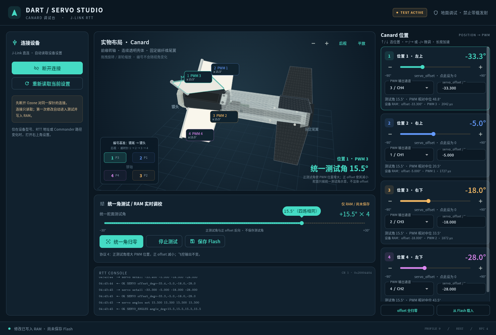

# Dart Servo Studio

Flutter / Dart 桌面调试台，通过 **J-Link RTT channel 1** 直接控制 GuideDart 的四路舵机。已提供 Linux Release 应用；Windows runner 已准备，但没有在本机编译验证。无需 Python 桥接、无需串口。


## 启动

```bash
cd /home/litwei/projects/dart_servo_studio
./run.sh
```

默认只显示**离线预览**，不自动连接、不自动驱动舵机。左侧点“连接板子”即可启动 J-Link 并自动读取设备配置；Host、端口、MCU 型号、SWD 速率等只在齿轮“连接设置”里。四个位置的滑条及两侧 −/+ 分别调整 -30°、0°、+30° 的绝对 PWM 脉宽（整数 µs）；中间统一滑条向四路发送相同测试角。

`./run.sh --build` 重建并启动；`./run.sh --dev` 以 Flutter 调试模式启动。SDK 位于本项目 `.tools/flutter`（已忽略），没有修改系统 PATH；也可以设置 `FLUTTER=/path/to/flutter/bin/flutter` 使用自己的 SDK。当前版本 Flutter 3.47.6 / Dart 3.13.5。首次从纯源码构建需要 Flutter SDK 和 Linux 的 clang、CMake、Ninja、GTK 3 开发环境，见 [Flutter 官方桌面文档](https://docs.flutter.dev/platform-integration/desktop)。

直接运行已构建应用不需要 SDK：

```bash
./build/linux/x64/release/bundle/dart_servo_studio
```

分发时需要复制**整个 `bundle/`**，不只是单个可执行文件。

重新构建并生成 Linux x64 灰度包（包含 Release bundle、启动脚本和灰度说明）：

```bash
./tools/package_linux.sh
```

产物位于 `dist/`，包括 `.tar.gz` 和同名 `.sha256` 校验文件；测试者解压后
运行 `./start.sh` 即可，不需要 Flutter SDK。此包仍要求目标机提供 Linux x64
图形桌面和 GTK 3 运行时。

离线预览无需 J-Link。连接实体探针时，从 [SEGGER 下载页](https://www.segger.com/downloads/jlink/)
选择 Linux（非 Linux ARM）的 64-bit TGZ Archive。解压后用
`JLINK_DIR=/path/to/extracted-jlink ./start.sh` 启动，或安装官方软件包并将
`JLinkExe` 加入 PATH。Commander 和 `libjlinkarm.so*` 应来自同一版本，均不随应用分发。

### Windows x64 发行包

在安装 Flutter 和 Visual Studio「使用 C++ 的桌面开发」工作负载的
[Windows x64 环境](https://docs.flutter.dev/platform-integration/windows/setup)中，从项目根目录运行：

```powershell
.\tools\package_windows.ps1
```

也可以在 GitHub Actions 手动运行 **Windows x64 release**。脚本将完整的 Release
应用和启动脚本打成 `dist/dart_servo_studio-windows-x64-v<版本>.zip`，并生成 SHA-256
校验文件。解压整个包后运行 `start.cmd`，无需安装 Flutter；如缺少 Visual C++
运行时，安装 [Microsoft x64 运行库](https://aka.ms/vs/17/release/vc_redist.x64.exe)。

连接探针请从 [SEGGER 下载页](https://www.segger.com/downloads/jlink/)选择 **Windows 64-bit Installer**，
在连接设置中填入已安装的 `JLink.exe` 完整路径，或将其目录加入 PATH。Windows 使用
同一版本的 `JLink.exe` 和 `JLink_x64.dll`，不要用 Linux 的 `.so`。发行包不包含 J-Link。

## 首次连接：先更新固件

请先用 Ozone / J-Link 烧录协议 **v8** 固件，GUI 本身不会下载、暂停或复位 MCU。连接设置齿轮内可选择与板上固件匹配的 ELF，GUI 只用 `nm` 读取 `_SEGGER_RTT` 地址。默认自行启动 J-Link Commander（`STM32F411CEUx`、SWD 4000 kHz）；若已有 RTT TCP 服务，可在齿轮中关闭此选项并连接该服务。不要让 Ozone 与 Commander 同时占用同一探针。

连接后 GUI 自动读取 RAM 中的三点 PWM、通道映射及 Flash 已保存值，并获取客户端控制租约。租约获取本身不移动舵机，但飞控从此不再覆盖 PWM。首次编辑自动启动手动测试租约，指令角回到 0°。两类租约均需续约，1500 ms 无续约后由固件释放。TCP 接口无认证，只应在受控调试环境使用。

## 操作流程

**务必断开发射动力，在静止、空载、机械无干涉的地面条件下操作。**

1. 右侧选择 **-30° / 0° / +30°** 模式，选中位置后，该舵机移动到目标角，其余回 0°。位置 1..4 分别是从镖尾看向镖头的左上、右上、右下、左下。
2. 三个模式都调整该点的**绝对 PWM 微秒值**，不是旧的 `servo_offset` 度数。滑条和 −/+ 只改 RAM；键盘 `↑/↓` 选位置，`←/→` 或 `-/=` 单次微调 1 µs，长按从 1 µs/拍逐步加速，最高 5 µs/拍，松开即停。
3. 调好 0° 中点后，用治具分别校准 -30° 和 +30°。未校准的一侧仍用默认 `2000/180 µs/°` 斜率；调整中点若跨过已有端点，该端点自动失效。统一角滑条可让四路同时输出相同测试角，观察实际一致性；该测试角不会保存到 Flash。
4. PWM index 下拉框修改真实 `Servo_ID` 输出映射；选择已占用通道自动与原舵机交换，保持一一对应。修改只写 RAM。
5. 「中点全回 1500 µs」只重置 RAM 中点；「从 Flash 载入」恢复已保存的三点 PWM 与映射到 RAM。只有明确点击「保存 Flash」才持久化，并在写入完成后回读验证。

PWM 计算：设 `P0 = zero_us`，负角侧为 `P0 + angle × (P0−P−30)/30`，正角侧为 `P0 + angle × (P+30−P0)/30`；未校准侧使用默认斜率，最终限幅 500–2500 µs。RTT 手动测试角与飞控 `Servo_SetAng()` 走同一输出函数，正角提高 PWM 脉宽。3D 舵面仅按统一 GUI 测试角示意，不把三点 PWM 数值渲染成舵面角；实际角度必须观察实物。

传感器校准页在客户端打开时才按需轮询 `cal icm/adxl info`；MCU 不主动定期推流。ICM 六面摆放建议只高亮推荐面，采样仍须人工确认。六面和 ADXL 相对 offset 的候选结果仅在 RAM；点击各自的 Flash 保存按钮并收到完成应答后才持久化。页面另展示 Flash 已保存的校准快照。

| PWM index | 实际输出 |
|---|---|
| 1 | TIM3 CH1 |
| 2 | TIM3 CH3 |
| 3 | TIM3 CH4 |
| 4 | TIM3 CH2 |

逻辑舵机编号是 `0..3`，PWM index 是 `1..4`；**0 / 5 是 TIM2 电机 / 保留端口，固件和 GUI 都不允许映射到这些端口。** 当前编译默认映射 `{3,2,1,4}`，上电优先恢复 Flash 中有效的映射与三点 PWM。

## 实拍模型与固定编号

参考用户提供的 `/home/litwei/Downloads/dart.jpg`：默认镖头左、镖尾右，横向平放。模型包含短圆钝透明头罩、前部黑色方形舵机舱、四片白色矩形 canard、连续透明打印壳体和后部固定黑色碳纤维尾翼。照片没有精确尺寸，模型为结构 / 方位示意，不是 CAD 测量结果。

- **前舵转轴位于最靠镖头的前缘**：整片白色舵面在轴后方，银色径向轴、根部舵盘、旋转方向提示共用同一轴线。调角时轴线固定，后缘绕轴摆动，不再绕舵面中间旋转。
- **中段不是伸缩圆筒**：使用一体的倒角方形截面透明壳体，去掉圆管、套环和台阶；加入表面打印纹理、内部细导轨、侧面小开口和透明后段盖板。表面纹理随三维面一起投影，尾翼使用细碳纤维编织纹理。
- 只有前部白色 canard 跟随统一测试角示意，黑色尾翼和舵机外壳始终固定。相机自动适配整个镖体的取景，使用固定的 −30°..+30° 测试角参考姿态包络，不依赖三点 PWM 数值，因此修改不会带动相机或使转轴在屏幕上漂移；主动放大后可以超出取景范围。



**编号基准已按用户确认固定为“从镖尾看向镖头”的后视图：**

```text
       位置 1（左上）      位置 2（右上）
                  \    /
                   镖轴
                  /    \
       位置 4（左下）      位置 3（右下）
```

重新映射后应重新核对实际舵面动作；位置编号不会自动修改固件的 `roll_dir` / `yaw_dir` / `pit_dir` 混控符号。

后视编号图始终显示在 3D 视图左下角，编号不会因旋转相机或交换通道而改变。可切换后视 / 恢复平放视角。界面位置 `1..4` 分别对应固件内部逻辑索引 `0..3`，不是 PWM 通道号；通道仍由实际读取值决定，不自动重置为 1、2、3、4。

例如位置 1 原来使用 PWM 1，改选 PWM 2：位置 1 改为 PWM 2，**原来使用 PWM 2 的位置自动改为 PWM 1**；其他位置不变。选择直接写入 RAM，保存 Flash 后重启恢复相同映射。测试遍历全部 16 种位置 / 通道选择，验证交换和一一对应。

## 安全 / 超时边界

- GUI 连接成功前先获取客户端控制租约，此后约每 450 ms 续约；断开时释放。MCU 1500 ms 未收到续约会恢复普通控制。手动测试角另有独立的 1500 ms 回中租约。超时检查在 RTT 输出背压前执行。
- 状态切换到飞行 / 校准时退出手动模式；非静止待机拒绝调角、映射及零点写入。Flash 忙时拒绝一般写操作，但始终允许手动停止。
- 应答超时 / 断链后不重发写请求，以免重复动作或消耗 Flash。结果不确定时重新连接并读取状态，不要假定“超时”就是“没执行”。
- Flash 保存先退出手动模式，避免等待保存期间心跳租约失效。写入失败不自动擦除；旧有效记录仍可恢复。
- 以上为软件保护，**CPU 被调试器暂停、固件卡死、供电异常时不能保证超时回中**，不替代断电 / 机械安全措施。关闭窗口 cleanup 已接入 Linux / Windows runner；强制 kill 时依赖固件租约兜底。
- 上位机只保存连接选项：Linux `$XDG_CONFIG_HOME/dart_servo_studio/settings.json`（默认 `~/.config/…`），Windows `%APPDATA%/dart_servo_studio/settings.json`。不在本机保存测试角、测试模式或设备三点 PWM / 映射。

## 开发与验证

```bash
./tools/check.sh
# 或分别执行
.tools/flutter/bin/flutter analyze
.tools/flutter/bin/flutter test
.tools/flutter/bin/flutter build linux --release
```

当前自动测试覆盖 RTT 客户端分帧/超时、Commander 生命周期、三点 PWM 的 RAM 修改与显式 Flash 保存、v8 不调用旧 `servo_offset` RPC、0° 绝对 µs 调节、长按期间等待 RTT ACK 时的微调队列、通道映射、租约与断链安全，以及不同窗口尺寸下的布局。固件侧另有 ARM GCC 构建、RTT/Servo/Flash 主机回归测试。尚未以实体治具验证角度精度和旋转方向。

可选原生 Release 窗口冒烟测试：`python3 tools/native_smoke_test.py`。该旧脚本主要验证连接/窗口生命周期；三点 PWM 行为以本项目 Flutter 测试与固件主机测试为准，不访问 USB。

Linux runner 默认使用 Skia：本机 Xvfb / Mesa 测试中默认 Impeller 的确认弹窗未正常显示，改用 Skia 后原生交互通过。可用 `DART_STUDIO_IMPELLER=1 ./run.sh` 显式尝试 Impeller；本应用不依赖 Flutter GPU API。

**没有自动下载固件、没有驱动实体舵机、没有在实体板上保存 Flash；这些仍需要你按上述地面流程验证。**

主要代码：`lib/services/` RTT / J-Link、`lib/controller.dart` 控制与租约、`lib/widgets/servo_scene.dart` 原生透视 3D 网格、`lib/widgets/dashboard.dart` 桌面界面。无第三方 3D 引擎或运行时网络资产依赖。
